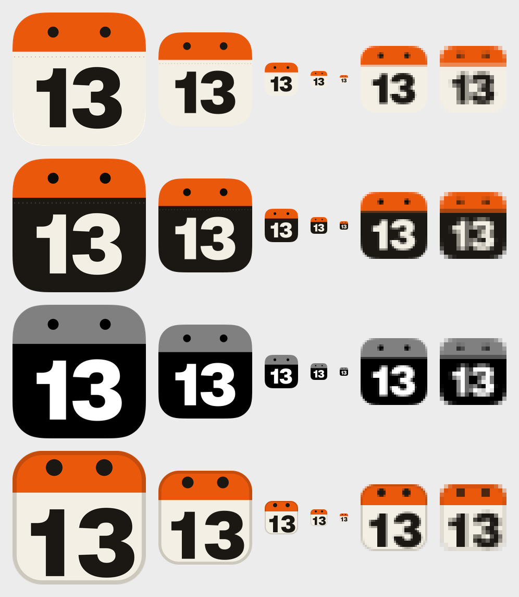
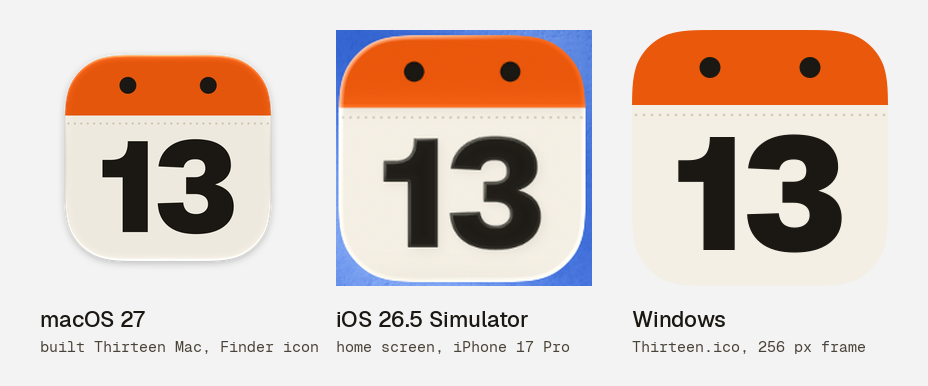

# Thirteen app icon: "Page 13"

A tear-off calendar page, full bleed. An orange binding band runs across the top with two ink ring
holes, and a large "13" in Geist Black sits on the paper below it. A faint perforation under the
band only shows at large sizes. Colours come from the Almanac theme (`packages/ui/src/styles/tokens.css`).



## One icon everywhere

Every platform uses the same 1024 master artwork at the same crop. Only the platform's mask
changes: the iOS/macOS squircle, the same continuous-corner squircle on Windows and the web, and
the Android adaptive mask (see `design/DECISIONS.md`). iOS and macOS also share a single PNG in the
asset catalog, so the two can't drift apart. The one exception is the 32 x 32 favicon, which is
redrawn pixel-snapped for browser tabs.



## Files

| File | What it is |
|---|---|
| `thirteen-icon.svg` | Master, 1024 x 1024, full bleed, no corners (the OS masks it) |
| `thirteen-icon-dark.svg` | Dark: ink page, paper "13", the same orange band |
| `thirteen-icon-mono.svg` | One colour (black on transparent): band with the holes cut out, plus "13" |
| `thirteen-icon-tinted.svg` | iOS tinted source: greyscale on black (white "13", band at 50 %) |
| `thirteen-icon-favicon.svg` | 32 x 32 favicon, pixel-snapped for 16 and 32 px, hairline page edge |
| `social-preview.png` | GitHub social preview, 1280 x 640 |
| `exports/android/` | Adaptive icon VectorDrawables, legacy mipmaps, 512 px Play Store icon |
| `exports/windows/` | `Thirteen.ico` (16, 20, 24, 32, 40, 48, 64, 256) and 44/150/310 px square logos |
| `exports/apple/AppIcon.icon` | The same artwork as an Icon Composer document (see Apple below) |
| `previews/` | Size ladders (light and dark backgrounds) and the built-icon check |
| `build.py` | Generates all of the above, plus the web icons and `assets/icon.svg` |

Every file is generated, so edit the constants in `build.py` rather than the outputs.

## Geometry (master, 1024 px grid)

| Element | Value |
|---|---|
| Canvas | 1024 x 1024, paper `#f4efe4`, full bleed |
| Binding band | y 0 to 300 (29.3 %), accent `#ea580c` |
| Ring holes | two ink `#1b1813` circles, r 42, centres (312, 150) and (712, 150): symmetric, centred in the band |
| Perforation | dots r 5.5 every 32 px at y 340, rule colour `#d5cab6`. They merge into a faint line at 180 px and disappear below 64 px |
| "13" | Geist Black (900), outlined. Cap height 452 px (cap 710 units, so 0.6366 px per unit). Tracking -64 units (-0.064 em) |
| "13" placement | ink box x 185.4 to 838.6 (653 px wide), centred on x 512. Cap top 428, baseline 880: the cap-height centre is at y 654, 8 px above the centre of the page area (662), to correct the optical drop |
| "1" | Geist's default flagged 1 without a foot. Stem 125 px. The gap between the 1 and the 3 is 50 px |

Dark: page `#1b1813`, holes `#0d0b08`, perforation `#3b352c`, "13" `#f4efe4`, band unchanged.

### Safe zones

The farthest content from the centre is the outer edge of a ring hole, at 455.6 px (0.445 of the
side). The farthest point of the "13" is 446 px.

- iOS and macOS: the squircle (corner radius 0.2237 of the side) only clips the band corners.
- Android adaptive icon (108 dp layers): the master fills the visible 72 dp, the same crop as iOS.
  Content reaches 455.6 x 72 / 1024 = 32.0 dp from the centre, which is inside the 33 dp
  safe-zone circle. Page, band and perforation bleed out to the 108 dp edges.
- PWA maskable: the art is scaled to 88 %, so the content stays within 0.392 of the side, inside
  the 0.4 safe circle. Page and band bleed to the edges.

### Favicon (32 x 32 grid)

Rounded page (r 7) and band 0 to 10 (5 px at 16). Holes are r 2 at (10, 4) and (22, 4), which
gives crisp 2 x 2 px dots at 16. The "13" has cap 16 (rows 7 to 14 at 16 px), cap centre at y 22
and tracking +10 units, so the digits stay apart, and the stem of the 1 is snapped to the pixel
grid. A hairline page edge (ink at 18 %) keeps the paper page visible on light tab bars. On dark
tab bars the paper page stands out by itself.

## Outputs and where they go

| Output | Path |
|---|---|
| Web favicon | `apps/web/public/favicon.svg` (the favicon SVG) |
| Apple touch icon | `apps/web/public/apple-touch-icon.png` (180, opaque, full bleed) |
| PWA "any" icons | `apps/web/public/icon-192.png`, `icon-512.png` (squircle, transparent corners) |
| PWA maskable | `apps/web/public/icon-maskable-512.png` (opaque, safe zone above) |
| Open Graph | `apps/web/public/og-image.png` (1200 x 630) |
| Repo mark | `assets/icon.svg` (squircle) |
| iOS + macOS | `apple/Shared/Resources/Assets.xcassets/AppIcon.appiconset` via `apple/scripts/make-icons.sh` |
| Android | `exports/android/` (copy `drawable/`, `mipmap-*` into `android/app/src/main/res/`) |
| Windows | `exports/windows/Thirteen.ico`, `Square44x44Logo.png`, `Square150x150Logo.png`, `Square310x310Logo.png` |

Android details:

- `drawable/ic_launcher_background.xml` holds the page, band, holes and perforation.
- `drawable/ic_launcher_foreground.xml` holds the "13".
- `drawable/ic_launcher_monochrome.xml` is the band with the holes cut out, plus the "13", for
  themed icons.
- `mipmap-anydpi-v26/ic_launcher.xml` and `ic_launcher_round.xml` are the adaptive icons.
- The legacy `mipmap-{m,h,xh,xxh,xxxh}dpi/ic_launcher.png` and `ic_launcher_round.png` are for
  API 25 and earlier.
- `play-store-512.png` is the store icon: opaque, full bleed, and Play applies its own mask.

## Apple

`apple/scripts/make-icons.sh` renders `AppIcon.appiconset` from the SVGs here. NSImage renders SVG
natively, so it needs nothing beyond Xcode:

- `icon-1024.png` is the full-bleed master. It is the iOS/iPadOS "any" icon and also fills the
  macOS 512 pt @2x slot, from which actool derives every smaller Mac size.
- `icon-1024-dark.png` and `icon-1024-tinted.png` are the iOS dark and tinted appearances. Asset
  catalogs have no Mac appearances.

What macOS 27 does with it, checked with `apple/scripts/app-icon-snapshot.swift` on a built
`Thirteen Mac`: the full-bleed square gets the system squircle mask and glass rim, with no grey
frame. The old pre-shaped 824 px tile was also accepted, but it picked up an embossed shadow on the
"13", and its artwork differed from iOS.

macOS 26 is different. Tahoe puts asset-catalog icons that are not already squircle-shaped into a
grey "squircle jail", and it could not be tested on this machine (macOS 27.0.1). The robust
answer for 26 and 27 is the Icon Composer document `exports/apple/AppIcon.icon`. It has the same
layers and geometry, plus dark and tinted fills (clear is derived from tinted), and it is checked
with `ictool --design-generation 26` and `27`. To use it:

1. Copy it to `apple/Shared/Resources/AppIcon.icon`.
2. Add this to `apple/project.yml` under `options:`. Without it, XcodeGen 2.44 treats the `.icon`
   bundle as a folder of loose resources:

   ```yaml
   fileTypes:
     icon:
       file: true
       buildPhase: resources
   ```

This was tried on a scratch copy of `apple/` with Xcode 27. actool compiled `AppIcon.icon` with no
warnings, alongside the appiconset of the same name, and it took precedence. The Mac app showed the
same squircle icon as the appiconset build.

## Rebuilding

```sh
# Geist (OFL) from the official release, kept outside the repo:
curl -L -o /tmp/geist.zip https://github.com/vercel/geist-font/releases/download/v1.8.1/geist-font-v1.8.1.zip
unzip -q /tmp/geist.zip -d /tmp/geist
pip install fonttools pillow          # plus: brew install librsvg harfbuzz
python3 design/icon/build.py --fonts /tmp/geist/geist-font
sh apple/scripts/make-icons.sh        # AppIcon.appiconset
```
